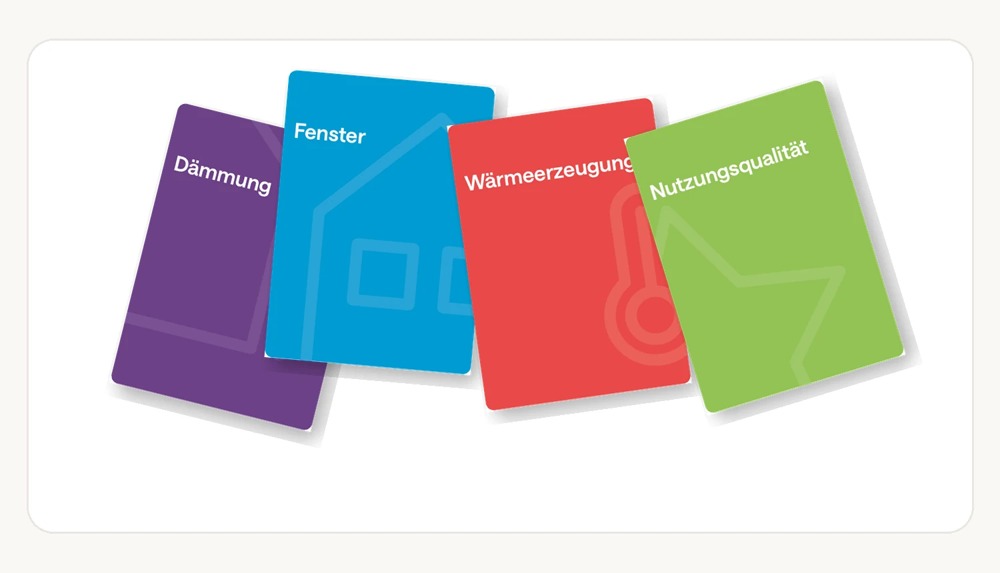

Kooperatives Serious Game · Klimafitte Stadtsanierung

Vier Runden. Ein Gebäude. Viele Entscheidungen.

Wie viel Klimaschutz steckt in neuen Fenstern, einer Wärmepumpe oder einer Photovoltaikanlage? In <strong>The Renovation Game</strong> saniert ihr gemeinsam ein Haus, vergleicht Maßnahmen und versucht, über vier Runden möglichst wenig CO₂ zu verursachen.

Ab 14 JahrenKooperativCa. 60–120 MinutenFür Schule, Lehre und Workshops

{.hero-art fig-alt="Originale farbcodierte Maßnahmenkarten von The Renovation Game."}

  <a class="action violet" href="spielen.html"><strong>Spielen</strong><small>Aufbau, wichtigste Regeln und Wertung – auch auf dem Smartphone.</small></a>
  <a class="action blue" href="vorbereiten.html"><strong>Vorbereiten &amp; Drucken</strong><small>Spielmaterial, Download-Paket und Duplex-Druckanleitung.</small></a>
  <a class="action green" href="start.html"><strong>QR-Code für die Klasse</strong><small>Auf dem Beamer zeigen – direkt zur mobilen Spielanleitung.</small></a>
  <a class="action red" href="feedback.html"><strong>Feedback geben</strong><small>Hilf uns, das Spiel zu verbessern und den Lernnutzen zu untersuchen.</small></a>

## Worum geht es?

Ihr habt ein gemeinsames Budget und renoviert ein bestehendes Wohngebäude. Eure Karten verbessern etwa **Wärmeschutz**, **Heizsystem**, **Stromversorgung** oder **Wohnqualität**. Manche Maßnahmen benötigen zunächst Material und Geld, sparen danach aber über mehrere Runden Emissionen. Entscheidend ist, **wie die Maßnahmen zusammenwirken**.

  
1<strong>12 Karten ziehen</strong>Maßnahmen gemeinsam ansehen.

  
2<strong>Renovieren</strong>Voraussetzungen prüfen und bezahlen.

  
3<strong>Haus werten</strong>Heizung, Strom und CO₂ berechnen.

  
4<strong>Weiterplanen</strong>Budget nutzen, nächste Runde starten.

<strong>Ein gutes Ergebnis?</strong> Je niedriger die gesamten CO₂-Spielpunkte, desto besser. Als Orientierung dient ein Ergebnis unter 300 Punkten. Die Spielwerte sind vereinfacht und ersetzen keine reale Gebäudeplanung.

[Spielregeln öffnen](spielen.html){.btn-game} [Regelheft als PDF](assets/downloads/regelheft.pdf){.btn-game .alt}
