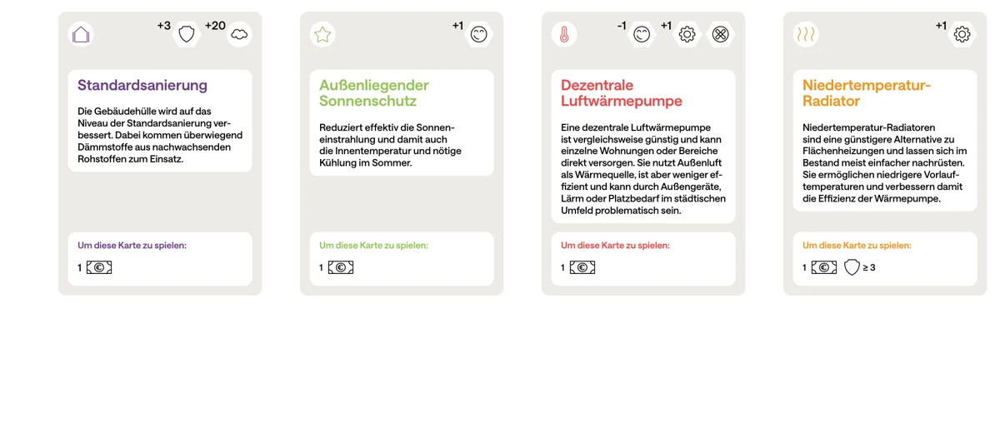

4 RundenGemeinsames Budget12 neue Karten je RundeCO₂ minimieren

<strong>Euer Ziel:</strong> Ihr saniert gemeinsam ein Haus. Nach Runde 4 addiert ihr die CO₂-Werte aller Runden. <strong>Je niedriger die Summe, desto besser.</strong>

## 1. Aufbauen

1. Legt **Gebäudeplan** und **Wertungsbogen** nebeneinander.
2. Stellt die Marker auf die **schwarz markierten Startpositionen**. Das Gebäude startet mit einer **Gasheizung**; der Wärmeerzeugungsmarker zeigt auf Gas.
3. Legt das gemeinsame **Startbudget von 3** bereit – mit Spielgeldmarkern oder auf einem Zettel.
4. Mischt alle Maßnahmenkarten und legt **12 Karten offen** aus.

## 2. Maßnahmen einbauen

Einigt euch auf eine Karte. Prüft zuerst **Voraussetzungen**, **Gebäudeplatz** und **Kosten**. Nur wenn genügend Geld vorhanden ist, dürft ihr sie einbauen. Bezahlt die Karte vollständig und legt sie auf den Gebäudeplan.

Danach verändert ihr die angezeigten Marker und notiert gegebenenfalls **Sofortemissionen**. Auf manchen Gebäudeplätzen kann nur eine Karte liegen; eine neue Karte darf die alte ersetzen. Vergleicht beim Tausch die laufenden Effekte und bewegt die Marker **nur um die Differenz**. Bereits entstandene Sofortemissionen bleiben erhalten.

{.example-cards fig-alt="Vier Original-Maßnahmenkarten als Beispiele aus den Bereichen Dämmung, Nutzungsqualität und Wärmeerzeugung."}

Ihr könnt weitere bezahlbare Karten spielen oder die Renovierungsphase beenden. **Nicht verwendete Karten werden am Ende der Runde abgelegt.** In der nächsten Runde werden wieder 12 neue Karten gezogen.

## 3. Das Haus werten

  
1<strong>Heizung</strong>Wärmeschutz + Heizsystem → Heiz-CO₂, Budgeteffekt und ggf. Wärmepumpenstrom.

  
2<strong>Strom</strong>Strombedarf + WP-Strom − Erzeugung − Speicherwirkung → Netzbezug.

  
3<strong>Budget</strong>Restgeld + Effekte von Zufriedenheit, Heizung und Netzbezug.

  
4<strong>CO₂</strong>Heizung + Netzstrom + sonstiger Betrieb + neue Sofortemissionen.

Der berechnete **Stromnetzbezug ist mindestens 0**. Eine Wärmepumpe erhöht den Strombedarf: Ihr lest diesen Effekt auf dem Wertungsbogen ab. Der **Effizienzmarker der Wärmepumpe** steigt durch passende Maßnahmen (zum Beispiel Wärmepumpe + Niedertemperatur-Radiator).

<strong>Kein Geld mehr?</strong> Beim Einbau darf das Budget nie negativ werden. Wenn nach einer Rundenwertung das Budget unter 0 fällt, ist eure Gruppe **bankrott** und das Spiel endet vorzeitig. Ihr könnt neu anfangen.

## 4. Nächste Runde und Spielende

Behaltet die eingebauten Maßnahmen und das verbleibende Budget. Zieht zwölf neue Karten und spielt die nächste Runde. Nach der **vierten Wertung** summiert ihr die vier CO₂-Rundenwerte. Geld- und CO₂-Marker können das handschriftliche Notieren ersetzen.

<strong>Wichtig fürs Verständnis:</strong> Einmalige Emissionen durch eine Maßnahme entstehen beim Einbau. Die Auswirkungen auf Heizung und Strom können sich dagegen in mehreren späteren Runden auswirken.

## Spielvarianten

**Kooperativ (empfohlen):** 12 zufällig gezogene Karten pro Runde, gemeinsam entscheiden. **Kreativ:** Alle Karten nach Kategorie geordnet frei auswählen. **Experte:** Kategorie wählen, drei Karten ansehen und höchstens eine davon installieren; übrige Karten entfernen.

## Wenn ihr mehr wissen wollt

Das [vollständige Regelheft als PDF](assets/downloads/regelheft.pdf) enthält die Kartenlegende, die detaillierte Wertung, Beispiele für zwei Runden und weitere Sonderregeln.

[Regelheft öffnen](assets/downloads/regelheft.pdf){.btn-game} [Feedback zum Spiel](feedback.html){.btn-game .alt}
