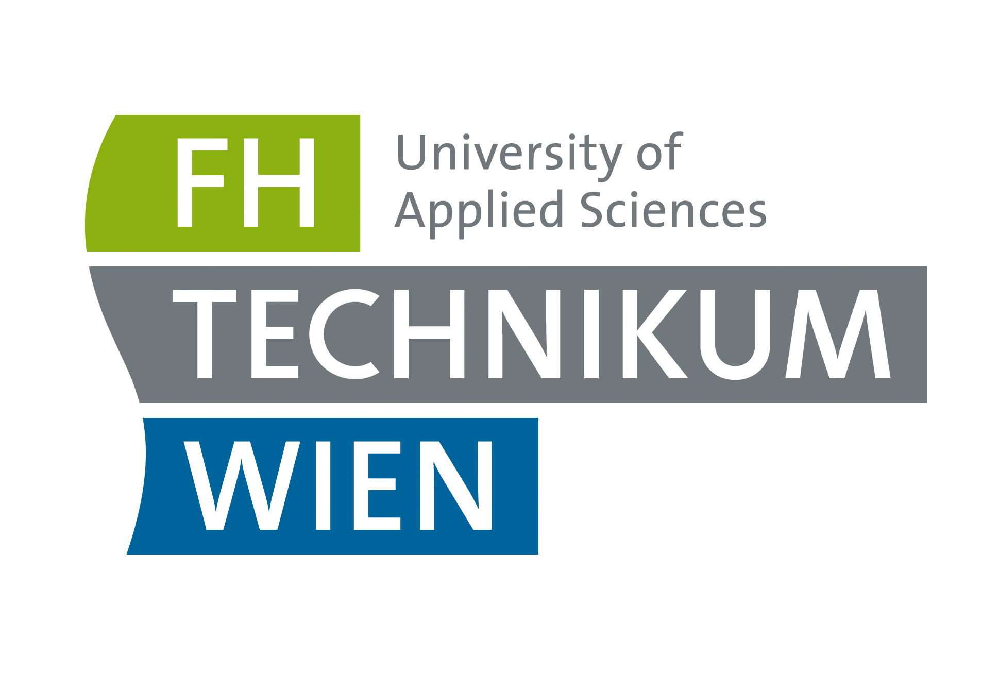

## Warum The Renovation Game?

Gebäudesanierung umfasst mehr als einzelne Technologien: Wärmedämmung verändert den Wärmebedarf, Heizsysteme benötigen unterschiedliche Energieträger, Photovoltaik erzeugt Strom und Speicher verschieben seine Nutzung. Im Spiel werden diese Wechselwirkungen sichtbar, während die Gruppe mit begrenztem Budget Entscheidungen treffen muss.

**The Renovation Game** richtet sich an Jugendliche ab 14 Jahren, Studierende und interessierte Laien. Es kann in Unterricht, Hochschullehre, Workshops und zur öffentlichen Wissensvermittlung eingesetzt werden.

## Fachlicher Hintergrund

Das Spiel verwendet vereinfachte Größenordnungen eines Wohngebäudes mit ungefähr **1.000 m²**. Eine Spielrunde entspricht ungefähr **fünf Jahren**; vier Runden bilden somit eine Betrachtung über zwanzig Jahre. Der CO₂-Spielwert steht näherungsweise für **kg CO₂-Äquivalente pro m²**. Aus den Spielzahlen kann  aber natürlich noch keine reale Sanierungsplanung abgeleitet werden.

Die Wertung macht unter anderem sichtbar, dass frühe Sanierung über mehrere Runden wirkt, dass Wärmepumpen von der Gebäudehülle und der Wärmeabgabe abhängen und dass der angenommene Strommix von Runde zu Runde klimafreundlicher wird.

## Das Projekt KlimSta

Das Spiel entstand im Projekt **„Stadt Wien Kompetenzteam für Klimafitte Stadtsanierung in der Lehre (KlimSta)“** an der **FH Technikum Wien**. Gefördert wurde das Projekt von der **Stadt Wien – Wirtschaft, Arbeit und Statistik (MA 23)** im Rahmen der Fachhochschulförderung.

Weitere Informationen: [Projekt KlimSta an der FH Technikum Wien](https://www.technikum-wien.at/forschungsprojekte/klimsta/) · [Climate-fit Buildings and Districts](https://www.technikum-wien.at/)

## Mitwirkende

| Aufgabe | Person |
|---|---|
| Spielkonzept und fachliche Entwicklung | Simon Schneider |
| Spielentwicklung | Thomas Verweyen |
| Grafische Gestaltung | Christian Witternig |

## Kontakt und Entwicklung

Die Spielmaterialien, Simulationen und Entwicklungsdateien werden im [GitHub-Repository](https://github.com/simonschaluppe/KlimSta-Brettspiel) dokumentiert. Für Workshops und fachliche Rückfragen: [Kontakt über FH Technikum Wien](https://www.technikum-wien.at/personal/simon-schneider/).

### Hinweise zur Nutzung

Die bereitgestellten Druckdateien dienen der Vorbereitung und Durchführung des Spiels. Bei weitergehender Veröffentlichung oder Bearbeitung der Spielgrafiken sind die jeweiligen Nutzungsrechte mit dem Projektteam zu klären.

[Feedback und begleitende Forschung](feedback.html){.btn-game}

::: {style="display: flex; flex-wrap: wrap; align-items: center; gap: 2rem;"}

{width=180px}

{width=220px}

:::
