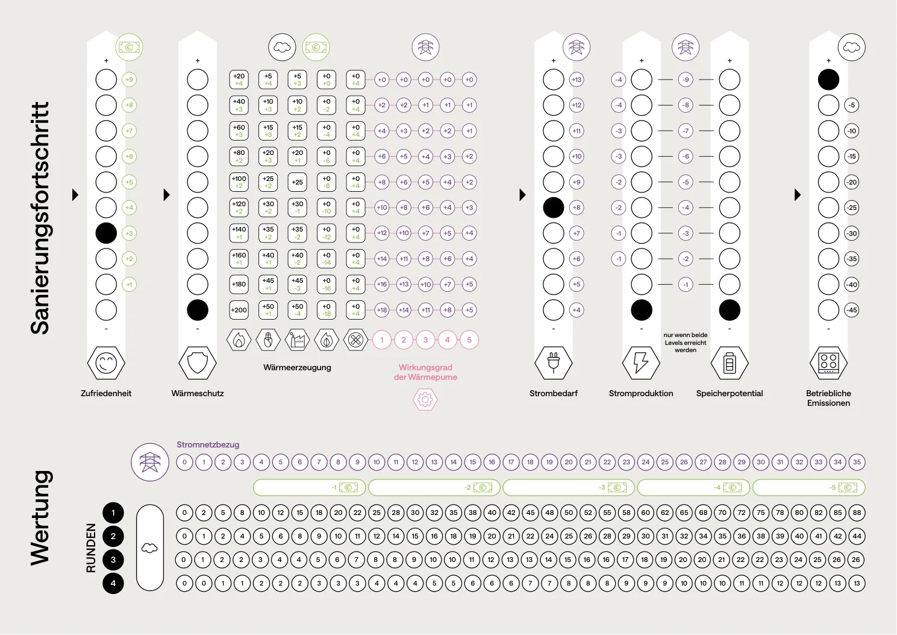
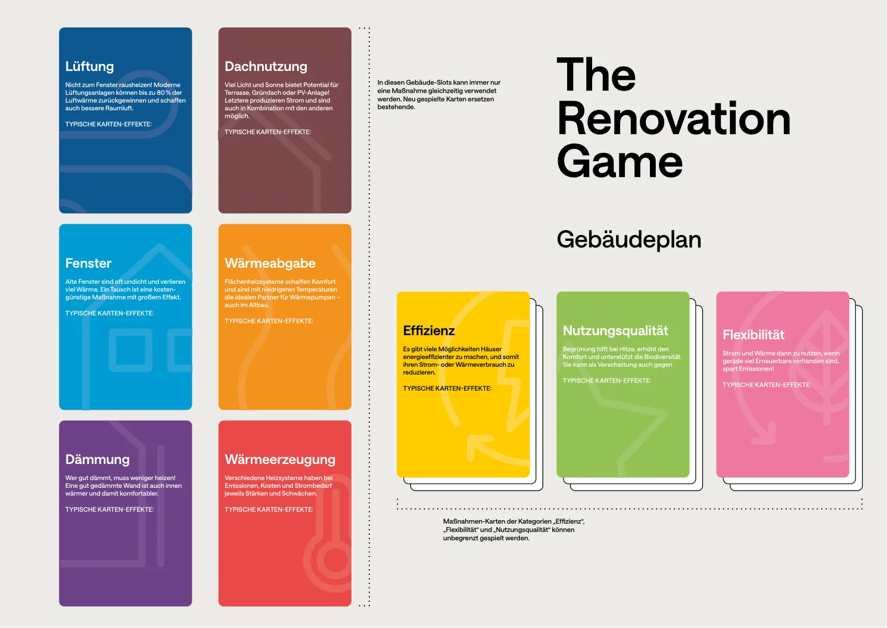

Pro Spielgruppe wird **ein Satz Spielmaterialien** benötigt. Für den Unterricht druckt ihr entsprechend mehrere Sätze aus. Die Dateien dieser Seite sind aufeinander abgestimmt und entsprechen dem Stand der bereitgestellten Druckvorlagen (Karten November 2026, Wertungsbögen und Marker September 2026).

<strong>Am einfachsten:</strong> Das Gesamtpaket herunterladen. Es enthält die PDF-Dateien einschließlich eines Testbogens für den zweiseitigen Kartendruck.

[Gesamtes Druckpaket herunterladen (ZIP)](assets/downloads/druckpaket-komplett.zip){.btn-game}

## Das braucht ihr pro Spielgruppe

| Material | Menge / Format | Hinweis |
|---|---|---|
| Maßnahmenkarten | 56 Stück, 63 × 88 mm | Auf 7 A4-Blättern, beidseitig gedruckt |
| Gebäudeplan | 1 × A3 quer | Einseitig, zeigt die Plätze für Maßnahmen |
| Wertungsbogen | 1 × A3 quer | Einseitig, mit Heiz-, Strom- und CO₂-Wertung |
| Marker / Spielgeld | 1 Markersatz, 4 × A4 | Ausschneiden; Geld- und CO₂-Marker sind optional |
| Regelheft | 1 × PDF pro Gruppe | Auf dem Smartphone lesbar oder gedruckt |
| Sonstiges | Schere, ggf. Stifte und Zettel | Optional: Karton / Kartenhüllen für dauerhafte Nutzung |

## Einzelne Druckdateien

 

<strong>Karten – A4-Duplex</strong>14 PDF-Seiten = 7 doppelseitige Blätter · 3 × 3 Karten · 1 mm Abstand
<a href="assets/downloads/karten-a4-duplex-1mm.pdf">PDF laden</a>

 

<strong>Wertungsbogen</strong>1 Seite, A3 quer, 100 % drucken
<a href="assets/downloads/wertungsbogen-a3.pdf">PDF laden</a>

 

<strong>Gebäudeplan</strong>1 Seite, A3 quer, 100 % drucken
<a href="assets/downloads/gebaeudeplan-a3.pdf">PDF laden</a>

 

<strong>Marker und Spielgeld</strong>4 Seiten, A4, einseitig
<a href="assets/downloads/marker-a4.pdf">PDF laden</a>

 

<strong>Regelheft</strong>Ausführliche Spielregeln und Beispiele
<a href="assets/downloads/regelheft.pdf">PDF laden</a>

 

<strong>Duplex-Testbogen</strong>2 Seiten A4 zum Prüfen der Rückseitenausrichtung
<a href="assets/downloads/karten-testbogen-a4.pdf">PDF laden</a>

## Karten korrekt beidseitig drucken

  
1<strong>A4 Hochformat</strong>Papierformat A4, eine PDF-Seite pro Blattseite.

  
2<strong>Duplex aktivieren</strong>Beidseitiger Druck: <strong>an langer Kante wenden</strong>.

  
3<strong>100 % Größe</strong>Keine automatische Verkleinerung oder Seitenanpassung.

  
4<strong>Erst testen</strong>Testbogen drucken, am Licht auf Deckung kontrollieren.

<strong>Wichtig:</strong> Drucker können Vorder- und Rückseite leicht gegeneinander versetzen. Kontrolliert deshalb vor dem gesamten Kartensatz mit dem Testbogen. Bei falscher Wenderichtung die Einstellung „lange Kante“ prüfen.

## Wertungsbogen und Gebäudeplan

 
{.board-preview fig-alt="Wertungsbogen mit Heiztabelle, Gebäudeeigenschaften und vier Runden."}<small>Wertungsbogen – A3 quer</small>

 
{.board-preview fig-alt="Gebäudeplan mit farbigen Kategorien zum Ablegen der Karten."}<small>Gebäudeplan – A3 quer</small>

Im Originalformat A3 lassen sich die Wertungsleisten gut ablesen. Wenn nur A4 verfügbar ist, kann verkleinert gedruckt werden; die Beschriftungen werden dann entsprechend kleiner.

## Vor dem Start

Gebäudeplan und Wertungsbogen nebeneinanderlegen, Marker auf die Startpositionen setzen (bei Wärmeerzeugung **Gas**) und ein gemeinsames Budget von **3** bereitlegen. Anschließend alle Maßnahmenkarten mischen und **12 offen auslegen**.

[Zu den Spielregeln](spielen.html){.btn-game} [QR-Code für den Unterricht](start.html){.btn-game .alt}
